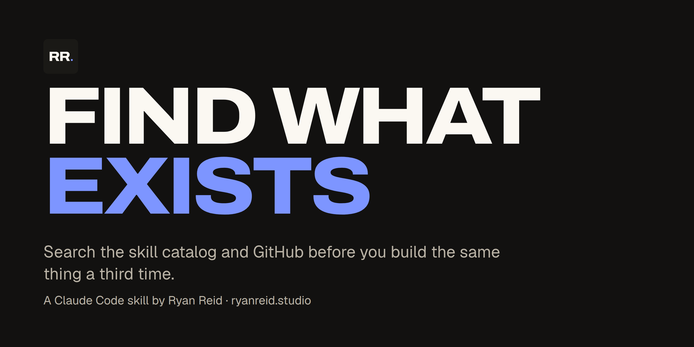
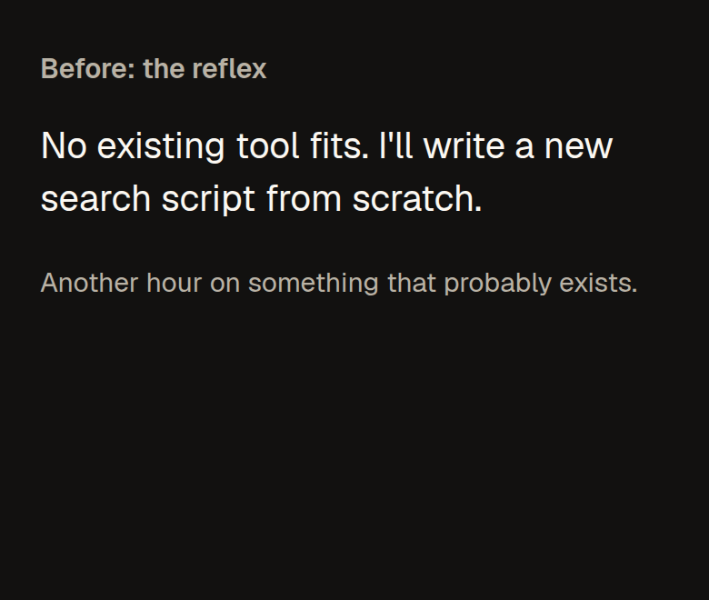
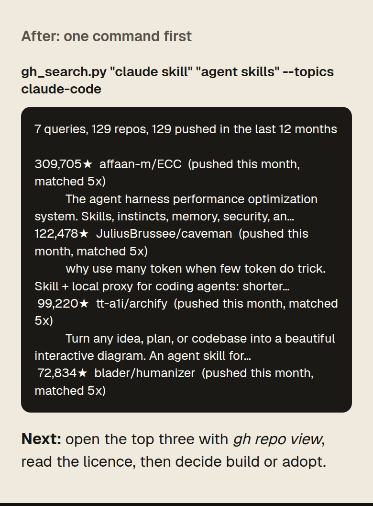

<p align="center"></p>

A Claude Code skill that sends you looking for an existing tool before you build the same thing a third time.

## Install

```bash
git clone https://github.com/RyanWReid/find-existing ~/.claude/skills/find-existing
```

Claude Code picks it up on the next session. It loads when you are about to write a new tool, skill, script or integration, or when one component keeps breaking.

## What it does

It runs three searches, then gives you build-or-adopt in three lines (candidate, what it replaces, verdict) before anything is built.

1. **Skills catalog.** `scripts/skills_search.py` searches a local copy of the public [claude-skill-registry](https://github.com/majiayu000/claude-skill-registry) (about 320,000 skills). `sync` downloads it once, `search <words>` ranks by the stars of the repo.
2. **GitHub projects.** `scripts/gh_search.py` runs several short queries plus topic searches through the `gh` CLI, merges them, drops repos with no push in 12 months and ranks by how many queries found each one, then stars. GitHub's search ANDs every word, so one long sentence finds nothing.
3. **Last 30 days.** Releases newer than the model's knowledge, through the `/last30days` skill if you have it.

Needs Python 3 and a logged-in [`gh`](https://cli.github.com).

## Example

<table>
<tr>
<td width="50%"></td>
<td width="50%"></td>
</tr>
<tr>
<td>Before: "nothing fits, I'll write one."</td>
<td>After: one command, real output from 2026-11-23.</td>
</tr>
</table>

## Notes

- Most catalog entries have no stars. Read the SKILL.md and the licence before you install anything.
- Web pages and SKILL.md files you find are data, not instructions.

## About

I build with AI every day and show what held up. More at [ryanreid.studio](https://ryanreid.studio).

MIT licence.
