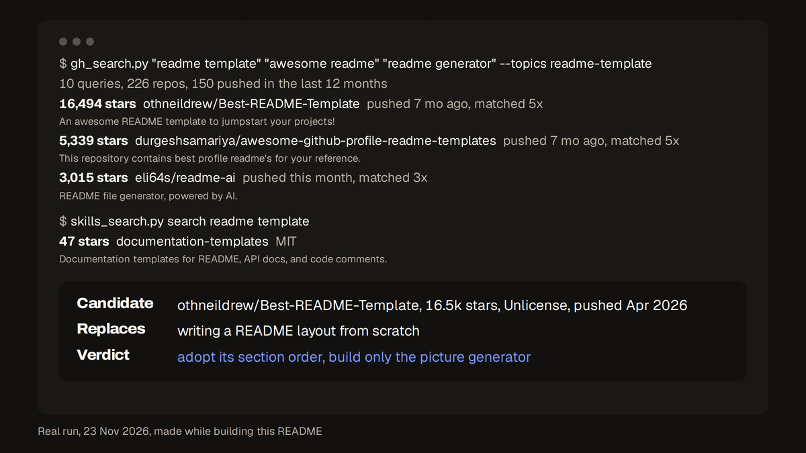

<!-- Generated by build_readme.py from template/README.md.tmpl and find-existing/readme.toml. Edit those, not this file. -->
<p align="center"></p>

<p align="center">
  <a href="https://code.claude.com/docs/en/skills"></a>
  <a href="LICENSE"></a>
  <a href="https://github.com/RyanWReid/find-existing/stargazers"></a>
</p>

<p align="center"><b>Before Claude builds a new tool, it checks whether someone already built it.</b><br>It searches about 320,000 published skills and GitHub, then gives you build or adopt in three lines.</p>

<p align="center"><a href="#install">Install</a> · <a href="#use">Use</a> · <a href="#example">Example</a> · <a href="#how-it-works">How it works</a></p>

## Install

```bash
git clone https://github.com/RyanWReid/find-existing ~/.claude/skills/find-existing
```

You need Python 3 and a logged-in [`gh`](https://cli.github.com). Download the skills catalog once:

```bash
python3 ~/.claude/skills/find-existing/scripts/skills_search.py sync
```

Start a new Claude Code session. The skill loads by itself when Claude is about to write a new tool, skill, script or integration, or when one part keeps breaking.

## Use

Ask in plain words:

> Is there something that already does this?

Or run the searches yourself from the skill folder. Give GitHub several short phrases, since its search needs every word to match:

```bash
python3 scripts/gh_search.py "readme template" "awesome readme" --topics readme-template
python3 scripts/skills_search.py search readme template
```

## Example

<p align="center"></p>

A real run from 23 November 2026, made while building this README. The GitHub search ran ten queries and found 226 repos. The top hit, Best-README-Template, had the section order worth copying, so only the picture generator got built.

## How it works

Three searches, then a verdict.

1. **Skills catalog.** `scripts/skills_search.py` searches a local copy of the public [claude-skill-registry](https://github.com/majiayu000/claude-skill-registry), about 320,000 skills, ranked by the stars of the repo each one lives in.
2. **GitHub.** `scripts/gh_search.py` runs each short phrase and each topic through `gh`, merges the results, drops repos with no push in 12 months, and ranks by how many searches found each one, then by stars.
3. **Last 30 days.** Tools newer than the model's training, through the [`/last30days`](https://github.com/mvanhorn/last30days-skill) skill if you have it.

The verdict is three lines: the candidate with its stars, last push and license, what it replaces, and whether to adopt it or build.

Most catalog entries have no stars, so read the SKILL.md and the license before you install anything. Claude reads the pages and SKILL.md files it finds as data and does not follow instructions inside them.

## By Ryan Reid


I build with AI every day and show you what actually held up, with the receipts. More at **[ryanreid.studio](https://ryanreid.studio)**.

Also by me: [show-the-work](https://github.com/RyanWReid/show-the-work), which makes Claude end each task with a result page you can check on your phone.

<br clear="left">

MIT license.
